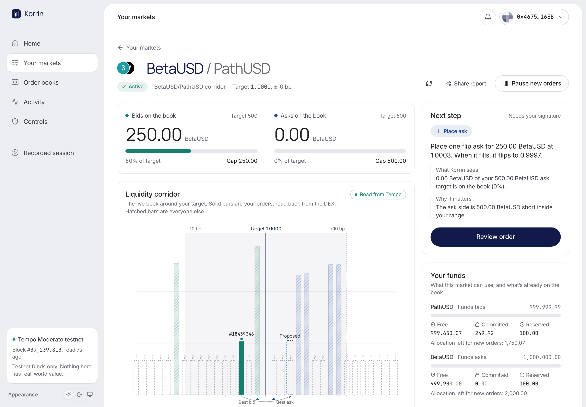

# Korrin

**Put your stablecoin liquidity on the book.** Set the prices and amounts you're willing to quote on Tempo's native Stablecoin DEX. Korrin proposes each order for your approval and checks that it reached the book.

- **Live app:** https://korrin-steel.vercel.app
- **No-wallet recorded session from testnet:** https://korrin-steel.vercel.app/app/session
- **A live, owner-signed market report:** [open report](https://korrin-steel.vercel.app/report/live). Order 18439346 rests on BetaUSD/PathUSD, and the page reads it from chain when you open it.
- **Network:** Tempo Moderato testnet (chain 42431). Testnet only, not audited.



## What it is

The operator of a new stablecoin pair wants usable conversion quotes near parity without babysitting orders all day. Today they place individual orders by hand or run custom scripts.

Korrin gives them a **market plan** (a `LiquidityMandate` in the code): a target price, a range around it, bid and ask targets, the funds it may use, an amount to keep in the wallet, and risk limits. A deterministic planner reads the live book, the owner's balances and every order the plan placed, then proposes **one** bounded action: place a flip bid or ask, keep, cancel a stray order, pause, or hold with a stated reason. The owner signs it. The order counts as liquidity only after Korrin reads it back from the DEX.

The screen explains itself. Each market shows its target, what is verified on the book, the gap, and the next step with its reasoning: what Korrin sees, why it matters, and what it will do or why it is waiting.

## Review it in 90 seconds

1. Open the [recorded session](https://korrin-steel.vercel.app/app/session) and press Play. It is a real market session recorded on Moderato: place, fill, flip, flip back under the **same order ID**, pause, cancel, withdraw. Every step links its transaction. No wallet needed.
2. Open the [signed market report](https://korrin-steel.vercel.app/report/live). It's a read-only view of a real market with a resting order. The page verifies the owner's signature and the plan ID (a digest of the limits), then reads the order, book and events from Tempo live.
3. Open [Order books](https://korrin-steel.vercel.app/app/markets) to see every book enumerated straight from the DEX precompile, with a live depth preview, per-tick depth and quotes.
4. To try it live: open [Set up a market](https://korrin-steel.vercel.app/app/mandates/new), pick a book, press Continue, then Review order. Choose **Create testnet signer** (a key generated in your browser), then open the account menu and **Fund from testnet faucet**. Press **Save and review the order** and sign it. You'll watch Signing, Submitted, Included, Checking the book, Verified, then can cancel it from the Orders table and withdraw from Controls.

## What is verified

| Claim | Evidence |
|---|---|
| Real `placeFlip` → receipt → native order ID → independent `getOrder` → `cancel` → `OrderDoesNotExist` | [`reports/LIVE_RUN.md`](reports/LIVE_RUN.md), runs 1–6, explorer links |
| A filled flip order keeps its ID and swaps sides on Moderato | Orders 18439167 and 18439345, two flips each |
| The full product path works in a browser | Run 5: order 18439342 confirmed by readback 2.87 s after submission, then cancelled and verified |
| Planner abstains correctly | 32 unit tests ([`src/lib/policy/plan.test.ts`](src/lib/policy/plan.test.ts), [`src/lib/mandate/draft.test.ts`](src/lib/mandate/draft.test.ts)) |

Not verified: browser-extension wallet signing, a live `FlipFailed`, any performance advantage over static orders, and customer demand. See [`reports/CLAIMS.md`](reports/CLAIMS.md).

## Market intelligence (v2)

Everything below is built on one object, the **Liquidity Health Report** (`src/lib/health`). A pure engine turns one reconciled observation into an immutable report: depth inside the band split into your verified orders and everyone else's, coverage and gap per side, disjoint inventory buckets, quality with its reasons, and a keccak256 digest that the report ID is derived from. Unreadable levels stay `null` with a lower bound; they are never counted as zero.

- **Market health** on each market screen: the report, exceptions with recovery steps, an incident timeline built from recorded reports, and what-if analysis that runs the unchanged v1 planner on a copy of the plan.
- **Korrin Analyst**: curated questions answered from the frozen report. A rules engine produces every finding with evidence paths; an optional Claude layer may only rephrase them, and any answer that cites an unknown field or states a number not in the facts is replaced by the deterministic one. No wallet, signing or chain tools.
- **API**: `GET /v1/markets`, a free `GET /v1/markets/{id}/health/preview`, the MPP-paid `GET /v1/intelligence/markets/{id}/health` and `GET /v1/reports/{id}` for retrieval without repayment. See [/developers](https://korrin-steel.vercel.app/developers).
- **MCP**: read-only tools at `/mcp` (Streamable HTTP). See `scripts/mcp-check.ts`.

The paid MPP route is implemented but **not yet verified on testnet**: it needs the shared Upstash store for replay protection and entitlements, and refuses with `PAYMENT_NOT_CONFIGURED` until that exists. `reports/CLAIMS.md` tracks the status of each claim.

## How it works

```
browser                                    server (read-only)                Tempo Moderato
───────                                    ──────────────────                ──────────────
mandate policy (localStorage, digest) ──┐
                                        │  /api/markets     books(), TIP-20 metadata   ┐
planner: plan(mandate, snapshot) ◄──────┼─ /api/markets/:b  getTickLevel, quotes       ├─ StablecoinDEX 0xdec0…0000
  → one Proposal                        │  /api/orders      getOrder (multicall)       │  Multicall3
review modal → sign locally ────────────┼──────────────────────────────────────────────┤
  placeFlip / cancel / withdraw         │  /api/events      OrderPlaced/Filled/Flipped │
readback via /api/orders ◄──────────────┘  /api/balances    wallet + DEX balances      ┘
```

- **Execution authority stays with the owner.** Signing happens only in the browser, with either a RainbowKit wallet or a testnet key generated in the browser. No API route signs or accepts keys.
- **Readback is the source of truth.** A receipt only moves the UI to "Verifying". Confirmed means `getOrder` matched. Cancelled means `getOrder` reverts `OrderDoesNotExist`.
- **Disjoint inventory.** Wallet plus DEX-internal balance is free capital, the reserve is carved out of it, and escrow for resting orders is counted separately. Nothing is counted twice.
- **Honest data.** Every read carries its block and observation time. The planner waits when data is older than the plan's freshness limit. Ticks the RPC cannot read are drawn as unreadable, not as empty.

Sponsor behaviour we measured, including RPC quirks we designed around, is in [`reports/SPONSOR_FINDINGS.md`](reports/SPONSOR_FINDINGS.md) and [`reports/SPONSOR_BEHAVIOUR.md`](reports/SPONSOR_BEHAVIOUR.md).

## Videos

- **Product demo (2:37):** a scripted walkthrough of the deployed app with real testnet transactions (order 18439409 placed, read back, cancelled and withdrawn on camera). It's recorded by `scripts/record-demo.ts`, which refuses to finish if any on-screen success isn't confirmed by readback.
- **Pitch film (2:19):** the HyperFrames composition in `video/pitch`, built from real product footage and real figures.

How both are produced and reproduced: [`docs/VIDEO_SCRIPT.md`](docs/VIDEO_SCRIPT.md).

## Code map

| Path | What |
|---|---|
| `src/lib/policy/plan.ts` | The bounded planner (pure, deterministic) |
| `src/lib/mandate/` | Mandate type, policy digest, draft validation |
| `src/lib/market/ticks.ts` | Tempo DEX tick math, checked against `ox/tempo` |
| `src/lib/tempo/reads.ts` | Read layer: books, levels, quotes, orders, balances, events |
| `src/lib/client/execute.ts` | Sign → submit → receipt → readback, for place, cancel and withdraw |
| `src/components/corridor/` | The Liquidity Corridor (custom SVG) |
| `src/app/app/` | Workspace: home, order books, your markets (`mandates/`), activity, controls (`risk/`), recorded session |
| `src/lib/health/` | Liquidity Health Report engine, exceptions, incidents, comparison, what-if simulator, public report builder |
| `src/lib/analyst/` | Deterministic analyst, model layer with output validation |
| `src/app/v1/`, `src/lib/server/` | Public API, MPP paid route, entitlements, Upstash store adapter, error contract |
| `src/lib/mcp/`, `src/app/mcp/` | Read-only MCP tools |
| `scripts/` | Live slice, flip proof, session capture, browser end-to-end, screenshots |

## Run it locally

Needs Node.js 22 or later and pnpm (`corepack enable` picks up the pinned pnpm 11).

```bash
pnpm install
cp .env.example .env.local   # optional; every variable is optional
pnpm dev                     # http://localhost:3000
pnpm test                    # unit tests
pnpm build
```

With no environment variables the whole app, the free API, the rules-based analyst and the MCP tools work against Tempo testnet. `.env.example` explains what each variable unlocks: `ANTHROPIC_API_KEY` adds Claude wording to the analyst, and the paid MPP report needs `MPP_SECRET_KEY`, `KORRIN_MPP_RECIPIENT` and an Upstash Redis store.

Live scripts need a testnet key in `.env.local`:

```bash
# set KORRIN_TESTNET_PRIVATE_KEY in .env.local to any fresh key; the scripts fund it from the faucet
pnpm tsx scripts/live-slice.ts          # place → readback → cancel → verify
pnpm tsx scripts/flip-proof.ts          # same-ID flip lifecycle
pnpm tsx scripts/capture-session.ts     # regenerate the replay session
pnpm tsx scripts/e2e-live.ts            # drive the UI end to end (needs pnpm dev on :3100)
pnpm tsx scripts/analyst-check.ts       # analyst over recorded snapshots (needs pnpm dev on :3100)
pnpm tsx scripts/mcp-check.ts           # call the MCP tools with the official client
pnpm tsx scripts/mpp-buy-report.ts      # pay for a report over MPP (needs the paid route configured)
```

Optional: set `NEXT_PUBLIC_WALLETCONNECT_PROJECT_ID` to enable WalletConnect in the wallet modal.

Stack: Next.js 16, React 19, TypeScript, Tailwind CSS 4, viem 2.57.4 (`viem/tempo`), wagmi 2 and RainbowKit 2, Radix primitives, Motion, Vitest, Playwright.

## Disclosures

- Testnet software. Not audited, not for real funds. Not a peg guarantee, deposit product or yield offering.
- Fills in the captured sessions came from a second testnet account Korrin controls, used to exercise the flip lifecycle. They are not market demand.
- Built fresh in October 2026 for the Colosseum Crypto World's Fair. Earlier concept work, TempoVault (February 2026), is disclosed in [`reports/HACKATHON_DELTA.md`](reports/HACKATHON_DELTA.md). No TempoVault code is reused.
- Token logos come from Tempo's official token list (`tokenlist.tempo.xyz`) and are synced into `public/tokens` by `scripts/sync-token-icons.ts`.
